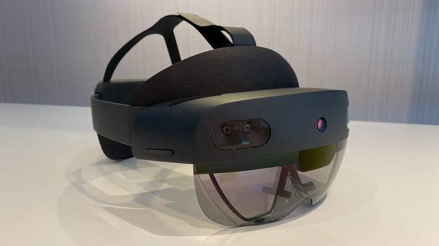

# Rice-Srt · HoloLens2 

>SRT阶段项目：AR眼镜嵌入式开发

### 菜单

架构 *[参考](docs/architecture.md)* ；
阶段产出 *[总览](docs/milestones/README.md)* ；
版本  *[下载](https://github.com/julibeian/hololens-terminal/releases)*

### 阶段任务

| 阶段 | 目标 | 状态 |
| --- | --- | --- |
| 1 | 电脑通过 USB 稳定连接眼镜 | √ |
| 2 | 在电脑上稳定操作眼镜内画面 | --> |
| 3 | 静态识别模型嵌入眼镜 | --> |
| 4 | 动态识别模型嵌入眼镜 | x |
| 5 | 前后端挂载 | x |

每项技术节点的迭代过程已保留仓库；最终解决方式为**最新方案**。

### 技术流程
静态
>拍照上传 → 云端处理 → 返回结果。

动态
>在线摄影 ⇌ 双端动态交互 → 返回显示标注。
### 产品

Microsoft HoloLens官网跳转[点击此处](https://learn.microsoft.com/zh-cn/hololens/)

