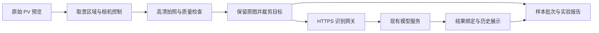

# 系统架构

## 应用与服务

`apps/field-app/src/` 实现眼镜平台适配，`upstream-miniprogram/` 固定共用界面与资源输入。构建器生成 UWP 使用的 HTML、脚本和样式。`apps/field-app/server/` 是独立识别网关，不在此进程中加载模型。

每次上传携带请求编号与图像 SHA256，客户端核对返回的 `capture_evidence`。重试复用同一任务身份，迟到响应不能覆盖另一张照片。原图、裁剪图与历史记录保持关联。

## 实验控制

根目录 PowerShell 与 `native/` 提供 USB/SSH 管理。`apps/holographic-control/` 通过官方显示与输入接口辅助设备实验，建立限时恢复保护后才发送输入，结束后恢复默认模式。

控制接口接受请求与用户实际看到结果分别验证。PC 工具服务于部署和调试；应用正常识别路径由眼镜直接访问云端。

## 模块边界

| 路径 | 用途 |
| --- | --- |
| `apps/field-app/` | 当前应用、网关与相关测试 |
| `apps/capture-app/` | 早期采集原型及复用的原生辅助工具 |
| `apps/holographic-control/` | 全息显示与输入实验工具 |
| `experiments/`、`data/` | 协议、结果与样本引用 |
| `resources/` | 文献、数据集与官方文档索引 |

设备名称、网络地址、SSH 指纹、门户凭据和原始诊断属于执行环境配置，不绑定到团队文档。
