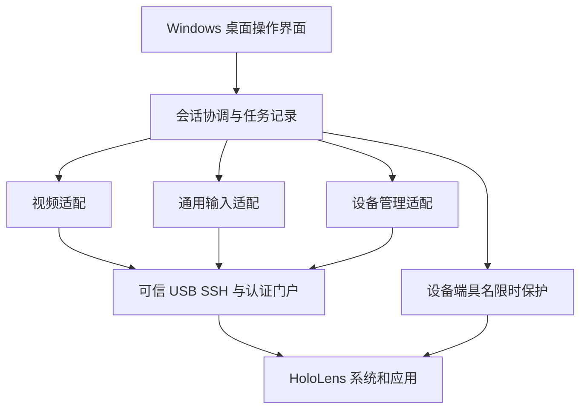

# HoloLens 二阶段整机可视化操作与管理规划书

版本 1.0  编制日期 2026 年 10 月 27 日  北京时间

本规划面向项目负责人和实施维护者，规定二阶段的产品目标、能力范围、技术路线、工作分解、验收方法和交付要求。目标是在 Windows 电脑上建立面向整台 HoloLens 的通用操作入口，让操作者看见设备当前界面，使用键盘鼠标完成系统与应用操作，并进行日常维护。稻视界、系统设置、浏览器及三维测试应用共同构成验证场景。

执行顺序为通用输入验证、跨应用交互、系统管理整合、桌面软件交付和完整验收。应优先解决会改变技术路线的输入与焦点问题，再投入界面扩建。现有成果作为实现基础；某一应用的成功不能代表整机范围已经完成。

## 一 项目目标与完成定义

### 1 核心目标

二阶段交付一套可复现的 HoloLens 电脑端操作与管理工具。操作者能够连接可信设备，看到真实全息画面，打开并切换多个应用，操作系统页面，输入文字，完成二维窗口和三维对象的常用交互，管理应用和文件，并在结束控制后恢复眼镜本地使用。

“整机”表示产品范围覆盖系统、应用、交互、设备维护和运行恢复。操作能力遵守设备实际开放的权限与接口；受保护界面和不可访问区域必须有明确结果，不能用空列表、旧画面或接口成功掩盖。核心能力无法实现时保留阻断，提出替代实现与范围取舍，不自动把缺项改成通过。

### 2 典型完整操作流程

从电脑启动工具，复用可信身份与已有认证，连接眼镜并显示开始菜单；进入系统设置查看状态，打开浏览器输入中英文并滚动页面；切换到另一二维应用完成点按和拖动，再进入三维测试应用移动、旋转和缩放对象；返回开始菜单，查看应用清单，传输测试文件，导出诊断记录；最后停止控制，核对控制流清理和设备正常模式。随后检查设备重启与电脑端中断后的恢复。

整体验收同时覆盖不同应用、不同交互方式和异常路径。应用启动命令、门户 HTTP 200、输入字节增加与画面可见变化分别记录。

### 3 版本层次与完成条件

| 版本层次 | 交付重点 | 可以宣布的结论 |
| --- | --- | --- |
| 基础可用版本 | 真实画面、通用点按、Home、跨应用启动、基础管理、可靠停止 | 基础控制可用，二阶段继续进行 |
| 二阶段完整版本 | 中英文输入、持续交互、三维操作、系统管理、异常恢复、第二台电脑复现 | 全部必备需求与验收用例通过后，二阶段完成 |
| 后续扩展版本 | 无线优化、多设备调度、双向音频、空间数据高级工具、自动化编排 | 按独立需求验收，不替代二阶段缺项 |

P0 表示应优先实现的前置能力，P1 表示整体验收必备能力，P2 表示后续扩展。P0 与 P1 都属于二阶段完成条件。没有实物条件或尚未证明可行的必备项目保持待验收状态。

## 二 现有基础与差距

### 1 已保存成果

基线取自 2026 年 10 月 27 日 19 时 11 分交付总结及对应过程记录，属于历史实测证据。实施开始时重新核对当前连接、实际版本和设备状态。[L01][L02]

| 能力 | 已有证据 | 对本规划的意义 |
| --- | --- | --- |
| USB 管理连接 | 原身份校验、桥恢复、会话重连；25 日及 27 日均有设备重启后恢复记录 | 复用第一阶段通道，不重新发明发现与配对 |
| 门户认证与证书 | 保存凭据复用、同公钥叶证书续签连续性检查 | 作为所有视频与管理请求的可信基础 |
| 微软原版真实视频 | 3.0.24.0 原版 GUI 经本机受限转发，显示 Start 与稻视界画面 | 官方显示链路已经有实测起点 |
| 官方会话恢复 | 正常停止、电脑进程中断、约 87 秒设备重启后重新连通 | 复用恢复方法，扩展成统一会话机制 |
| 自制控制后端 | 已记录范围、菜单、历史、原图与 Home 等具体操作 | 可复用输入编码及部分定位方法，继续验证通用性 |
| 应用拍摄链路 | 1.0.0.22 非叶片新拍、裁剪、上传和返回结果绑定 | 作为应用回归样本，独立于整机控制完成度 |

### 2 尚未闭合的关键问题

官方 GUI 的显示与输入结果分离：存在控制 WebSocket 和输入流计数，但最新轮次的鼠标键盘未稳定驱动可见控件变化；部分早期轮次曾出现朝向变化或悬停观察。应保留全部时间顺序，通过包、焦点、位姿和画面联合定位，不能先认定某个单一根因。[L01][L02]

现有桌面程序默认激活稻视界，存在固定应用操作入口；准星定位依赖小型中性色圆环与有限几何校准，换主题、应用、窗口姿态或三维场景后尚未证明稳定。现有控制命令包含单次 tap、Home、头部和手部位姿，没有完整的按下到释放、通用滚动和文本协议。[L03][L04]

完整 Windows 窗口流程、系统设置与其他应用、中文输入、持续拖拽、双手操作、长时间控制、第二台电脑复现仍缺少完整验收。现有 300 秒设备保护是测试机制，连续会话的续期与中断恢复需要另行设计和验证。

### 3 资料与平台约束

目标设备按现有材料为 HoloLens 2、ARM64、Windows Holographic；具体系统版本以每轮只读查询为准。设备管理账户不等于传统管理员，固件也不能按普通 Windows 电脑假设具备 CMD 或 PowerShell。[L05]

微软文档提供 Perception Simulation、门户虚拟输入、显示及设备管理接口，支持作为候选技术基础；接口在本机和当前固件上的行为仍须实测。Device Portal 属于开发管理工具，因此当前交付定位为配对开发设备的桌面控制和维护工具；若未来进入组织生产部署，应另行评估部署与管理体系。[W01][W02][W03]

## 三 需求范围与优先级

### 1 通用操作需求

| 编号 | 需求与预期结果 | 优先级 | 主要验收 |
| --- | --- | --- | --- |
| F01 | 自动发现原设备，核对身份，复用认证；区分离线、认证失败和未知状态 | P0 | A01 A02 |
| F02 | 显示真实全息画面，标明视频来源与新鲜度，支持窗口缩放和本机截图 | P0 | A03 A04 |
| F03 | 鼠标指向不同应用目标；支持校准和失效检测，错误定位时阻止输入 | P0 | A05 A06 |
| F04 | 点按、按住、释放、长按、拖动与滚动；异常时释放全部按键和手势 | P1 | A07 A08 |
| F05 | 调整观看视角和距离；移动缩放二维窗口，操作三维对象的位置旋转与尺寸 | P1 | A09 A10 |
| F06 | 打开开始菜单，枚举可启动应用，按真实包身份启动和切换，返回前一应用 | P0 | A11 A12 |
| F07 | 在目标输入框输入英文、数字、中文、符号和换行；支持删除与常见编辑键 | P1 | A13 A14 |
| F08 | 在普通系统设置和对话框中完成查看、选择和允许的设置操作 | P1 | A15 A16 |

### 2 设备维护与产品需求

| 编号 | 需求与预期结果 | 优先级 | 主要验收 |
| --- | --- | --- | --- |
| F09 | 列出应用，安装更新指定测试包，按精确身份停止和卸载目标 | P1 | A17 A18 |
| F10 | 浏览实际可访问目录，上传下载文件，校验完整性并保留失败信息 | P1 | A19 A20 |
| F11 | 查询网络、电源、电量和存储；支持已验证设置的修改、读回及恢复 | P1 | A21 A22 |
| F12 | 查看进程与设备诊断，导出日志和崩溃材料，保留权限拒绝和不完整结果 | P1 | A23 |
| F13 | 截图录屏；明确画面、相机和声音来源，控制保存位置与采集状态 | P1 | A24 |
| F14 | 统一只读观看与输入控制会话，处理竞争、失焦、中断、退出和设备恢复 | P0 | A25 A26 A27 |
| F15 | 提供统一 Windows 桌面入口、状态反馈和依赖诊断，完成第二台电脑复现 | P1 | A28 A29 |
| F16 | 提供会话记录、版本与哈希关联、性能统计及持续运行验证 | P1 | A30 A31 A32 |

音频规划分为应用声音监听、设备麦克风采集和电脑向眼镜回传三类。录屏界面应有明确音频选项；应用音频随视频监听作为 P1 兼容性验证，麦克风默认关闭。双向通话、语音模拟输入列为 P2，不能由视频流参数存在推断已经可用。[W02]

### 3 必须单独记录的边界

首次设备设置、实体接线、硬件故障、关机后无可用远程唤醒路径、Windows Hello 与其他受保护界面，分别记录所需条件。自动登录和低功耗恢复继续保留独立问题编号；有实现证据前不承诺无人值守冷启动到桌面。

文件浏览只展示当前通道实际允许访问的目录和授权应用数据。遇到受限路径应显示拒绝原因，不能宣称具备全盘访问权限。空间地图和锚点的导出可列 P2；重置地图、恢复出厂、账号变更和固件升级不纳入默认操作流程。

真实叶片、多光照和识别准确率继续按独立实验推进，不作为通用控制软件的先决条件，也不能用控制测试代替。USB 为首个交付通道；无线和 IPv6 备用链路是扩展方向，现有未完成通路保持未完成。

## 四 产品使用方式与界面规划

### 1 主窗口

主窗口中央为实时画面，保留画面原比例并正确处理留白、缩放和 DPI。上方显示设备身份简称、连接状态、观看或控制模式和画面更新时间；工具栏提供连接、开始控制、停止并恢复、开始菜单、应用切换、截图和录屏。失去新画面时明显标记画面已停滞，并停用输入。

侧栏提供应用、文件、设备设置和诊断四类工作区。它们共享同一个设备会话和任务记录，避免不同页面重复连接设备。稻视界作为应用列表中的普通条目，可以收藏，启动控制时不强制打开它。

### 2 输入模式

普通指向模式用于点击和滚动；视角模式用于转头和移动；三维操作模式显式区分手部移动、抓取和双手变换；文字输入区先在电脑完成输入法组合，再向当前已确认焦点的目标发送。切换模式时释放上一模式持有的状态，避免拖动残留或文字发错位置。

界面展示操作者能理解的状态，如正在连接、可观看、可控制、画面已停滞、正在恢复、恢复待核对。SDK 位姿、WebSocket 路径、CSRF 等实现细节放入诊断页，不作为日常操作步骤。

### 3 任务反馈

应用安装、文件传输、日志导出和设备重启均有任务编号、进度、结束结果与记录入口。用户能区分请求已接受、操作处理中、已核实完成和结果未知。会改变当前工作状态的重启、卸载和覆盖操作，在界面展示确切对象与影响；常规查看和已授权操作保持直接可用。

## 五 总体架构与模块职责

### 1 分层关系

桌面界面通过会话协调层使用视频、输入和设备管理适配器。可信连接层统一复用第一阶段 USB SSH 与认证门户；设备端限时保护独立于电脑进程运行。日志与证据模块贯穿所有层，使界面动作可以关联到请求和可见结果。

| 模块 | 职责 | 建议复用或新增位置 |
| --- | --- | --- |
| 设备发现与可信连接 | 发现候选地址、核对身份、桥状态、认证与证书连续性 | 根目录桥与连接脚本，Holographic.Common.ps1 |
| 会话协调 | 状态转换、观看和控制分离、互斥、清理、恢复查询 | 重构 DeviceSession，增加通用会话模型 |
| 视频适配 | 获取显示流、解码、帧标记、尺寸变更、录屏和来源标注 | 复用现有视频和 FFmpeg 管道 |
| 输入适配 | 位姿、手势、按下释放、键盘文本、焦点与映射策略 | 扩展 PerceptionControl，独立文本通道 |
| 管理服务 | 应用、文件、网络电源、进程、日志与任务回执 | 包装第一阶段与门户能力 |
| 桌面界面 | 通用控制视图、侧栏、任务与诊断，减少业务应用绑定 | 复用现有 Windows Forms，按验证结果演进 |
| 设备端保护 | 具名所有权、独立到期、恢复正常模式与回执 | 复用 hl-simulation-lease，续期单独立项 |
| 证据与配置 | 配置版本、日志脱敏、源码与运行摘要、兼容矩阵 | 新增独立 schema 和验收目录 |

### 2 技术选择原则

第一轮保留可用的 Windows Forms 与现有控制进程，先证明输入和跨应用能力。通用业务逻辑从固定界面和具体应用身份中分离，接口至少划分为连接、视频、输入、应用管理、文件管理与诊断。只有明确的部署或维护收益足以抵消迁移成本时，才另行评估桌面框架重写。

legacy x86 编码器与微软 3.0.24.0 x64 SDK 使用独立适配进程和匹配的依赖目录，不在一个进程中混装。主界面只依赖统一操作协议；官方 GUI 是独立对照客户端。临时认证转发保留进程身份、私有凭据传递和自身流约束，不能扩大为任意程序的常驻代理。

### 3 通用操作协议

每项操作至少包含 operationId、sessionId、设备身份引用、目标类型、参数、开始时间、执行状态和错误信息。应用目标使用枚举得到的 AUMID 或包身份，文件目标使用实际根目录与规范化相对路径。用已安装数据生成目标，避免手写猜测。

输入结果分为请求接受、协议传输、设备输入状态和可见效果四层。管理结果再保存读回值或文件摘要。需要去重的副作用操作保持相同 operationId，超时后查询原结果；禁止依靠不断生成新编号重复提交未知结果。

## 六 关键技术验证与路线决策

### 1 官方输入与焦点问题

建立最小可复现会话，只观察本项目和官方进程。分别记录电脑前台窗口与焦点、按键消息、SDK 人体位姿、输入包时间与长度、门户流状态及前后画面。选取开始菜单、设置和一个独立测试页；每次只改变一个变量，保存相同格式的结果。

验证顺序为直接 SDK 生成单次已知手势、同一设备上的自制输入、官方 GUI 输入，再分别改变焦点、鼠标捕获、输入源开关与输入法。手势按钮能生成数据但不能选择目标时，应进一步检查输入状态与应用接收；不能仅以字节量判断成功。

该问题安排最多 3 个有效工作日的第一轮调查。届时提交根因证据或收敛的未解问题，并决定继续修复官方路径或采用已验证 SDK 适配器作为主输入。官方 GUI 的未通过项独立保留，不阻止通用产品沿其他已证明路线继续开发。

### 2 鼠标坐标与通用目标定位

先完成窗口坐标到视频内容坐标的缩放、留白与 DPI 转换，再估计头部和手部位姿到屏幕射线的位置映射。分离视角变化、观看距离与目标平面，避免在所有应用上复用一个固定校准矩阵。

圆环识别可作为一种定位方法，同时记录置信度、候选数量、坐标误差和背景变化。遇到无圆环、不同颜色、三维目标或遮挡时，应切换已验证策略或请求重新校准。切换应用、调整窗口或改变视角后使旧映射失效；不能继续沿用稻视界专用假设。

### 3 持续手势与三维交互

输入层增加按下、移动、保持和释放的完整生命周期，以及双手独立状态。失焦、断流、会话取消、控制到期和异常退出均触发释放。先在二维滑块和列表上验证持续输入，再在三维样本中验证单手移动与双手旋转缩放；人体和手部模拟以官方 SDK 模型为候选基础。[W07]

三维测试样本仅用于测量操作结果，可显示对象初始与最终位姿；它不应成为控制其他应用的必要插件。通用能力仍须在一个未为本工具增加接口的应用上复测。确需应用专用接口时单独标为适配能力。

### 4 文本与中文输入

以门户 Virtual Input 和实际存在的键盘接口为候选路径，先核对当前固件的协议、编码和焦点行为，不预设未验证的 REST 路径。按键事件与文本提交分别实现；输入法组合在电脑侧完成，优先验证 Unicode 文本提交。[W03]

测试覆盖中文、英文、数字、标点、空格、换行、删除、方向键和组合键。长文本分段必须保持顺序并能取消；结果未知时不自动重发整段。密码等敏感字段不进入日志。无法确认目标焦点时先让操作者在新画面中确认，避免向错误窗口发送文字。

### 5 两类视频与音频

常规观看优先复用已经有记录的全息采集流；模拟控制时验证 simulation display 与输入的同步行为。两种流分别标注来源、分辨率和能力，不能把独立 PV 相机画面当作系统界面。仿真显示与 MRC 的官方接口说明是路线依据，实际画质和延迟按当前固件测量。[W02]

应用声音监听与麦克风采集分别测试；录屏保存所选轨道与参数。视频读取、解码、界面绘制各有独立心跳；相同像素的静止画面可以是正常状态，不能只凭像素不变判定卡死。接收帧数增长也不能代替源时序与解码状态检查。

### 6 设备管理接口

逐项探测门户和 SDK 支持的应用、文件、网络、电源及诊断能力，形成能力表。微软公开的应用部署与文件接口提供实现起点；平台标注、权限和版本差异仍需核对。安装之后读回安装状态和真实包版本，启动之后继续核对运行与可见画面。[W04]

设置修改使用读取旧值、执行、读回和恢复的流程。网络设置需先保留 USB 管理通道；电源与休眠操作要记录是否会失去远程路径。进程探针必须保留枚举失败和身份读取错误，不用空筛选证明进程已退出。

## 七 会话生命周期与恢复设计

### 1 会话状态

状态依次包括未连接、正在发现、身份已核对、可观看、正在获取控制、可控制、正在恢复和恢复待核对。视频停滞、设备离线与认证失败是独立原因。只有完成恢复核对后才显示已恢复；历史最后一次成功与当前状态分开显示。

只读观看不自动获得输入权。开始控制前检查是否存在其他控制方，建立具名设备保护并记录初始模式；已有其他控制会话时不抢占。清理只处理本会话创建的流，流标识保持原始大小写。

### 2 停止顺序

先停用新输入并释放所有按键和手势，再关闭本会话控制流，停止视频相关子进程，查询同名设备保护并确认 Default(0)。保留清理失败的流标识引用和错误，后续查询同一会话补核对。电脑进程退出不能直接等同设备已恢复。

### 3 连续会话与租约

短期测试继续使用现有 300 秒独立保护。产品连续控制若采用续期，必须先扩展设备端协议并单独验收：只有当前可信会话、新画面和正常心跳才能续期；每次续期后剩余保护时间最多 300 秒；失去电脑心跳后设备独立恢复。

续期功能未通过前，界面保持现有限时控制，明确到期与重新开始。不能用电脑端无限循环创建新流的方式伪装成长时间可靠控制。观测期内的真实佩戴输入与模拟输入可能相互影响，需独立验证本地接管行为并记录操作要求。

## 八 工作分解与交付安排

### 1 里程碑与工期

以下为一条主要实施工作流的初步估算，每个有效工作日约 6 小时，计入开发、真机测试与文档。日期从实际启动和设备可用时计算，不构成固定完成承诺。角色可以由同一维护者兼任；实施进度按里程碑产物判断。

| 里程碑 | 工作内容 | 工作日 | 退出条件 |
| --- | --- | --- | --- |
| M0 范围与基线 | 固定需求、证据索引、环境和能力清单，修正文档导航 | 1 至 2 | 需求与现有成果可以逐项追踪 |
| M1 通用输入验证 | 官方问题调查、主输入选择、Start 与设置和独立应用最小操作 | 3 至 5 | 跨三类界面完成可见选择；路线决定有依据 |
| M2 跨应用交互 | 通用定位、文本、持续手势、二维窗口与三维交互 | 6 至 9 | F03 至 F08 的核心用例通过 |
| M3 系统管理 | 应用、文件、网络电源、诊断、音视频保存 | 4 至 6 | 管理操作有读回和失败处理证据 |
| M4 统一软件 | 通用界面、会话状态、依赖诊断、安装更新与配置 | 4 至 6 | 基础软件可按手册独立使用 |
| M5 完整验收 | 故障注入、持续运行、第二台电脑、发布资料 | 4 至 6 | 全部必备验收与交付检查通过 |

基准合计 22 至 34 个有效工作日，约 132 至 204 小时；另留 20% 调查与兼容缓冲，按整日向上取整，计划容量为 27 至 41 个有效工作日。缺少第二台电脑、设备需现场处理或平台能力受阻的等待时间另计。M1 若没有通用可见选择证据，应暂停扩大界面开发，先调整路线和估算。

### 2 可执行任务清单

| 任务 | 工作与产物 | 前置任务 | 对应需求 |
| --- | --- | --- | --- |
| T01 | 固定当前源码与证据索引，列明未提交改动和历史记录 | 无 | F16 |
| T02 | 建立设备与电脑环境清单，区分已安装依赖和候选依赖 | T01 | F01 F15 |
| T03 | 建立能力登记表与统一结果格式，冻结 P0 P1 清单 | T01 | 全部 |
| T04 | 构建独立系统输入验证场景与对照记录器 | T02 T03 | F03 F06 |
| T05 | 调查官方焦点和输入链路，提交路线决策记录 | T04 | F03 F14 |
| T06 | 将固定稻视界启动改造为通用应用身份模型 | T03 | F06 F09 |
| T07 | 完善视频源、帧状态、DPI 和窗口缩放处理 | T02 | F02 |
| T08 | 拆分定位策略与几何校准，覆盖不同背景和应用 | T05 T07 | F03 |
| T09 | 实现按下移动释放和异常全释放 | T05 | F04 |
| T10 | 验证滚动、滑块、长按与连续拖动 | T08 T09 | F04 |
| T11 | 实现 Unicode 与按键分离通道及焦点确认 | T04 T06 | F07 |
| T12 | 增加三维操作样本，验证双手和对象变换 | T09 T10 | F05 |
| T13 | 完成系统设置与多应用功能用例 | T06 T10 T11 | F06 F08 |
| T14 | 封装应用列表、部署、状态查询和精确停止 | T06 | F09 |
| T15 | 封装文件根目录、传输、取消与摘要校验 | T03 | F10 |
| T16 | 封装网络电源与设备状态，验证读回恢复 | T02 | F11 |
| T17 | 封装进程、性能与日志导出，保留不完整状态 | T03 | F12 |
| T18 | 实现截图录屏、来源标识与应用音频验证 | T07 | F13 |
| T19 | 统一会话状态、控制互斥与正常清理 | T05 T09 | F14 |
| T20 | 开发并验证受限续期或明确的限时重启会话流程 | T19 | F14 F16 |
| T21 | 统一桌面主窗口、工作区与任务反馈 | T06 至 T19 | F15 |
| T22 | 增加依赖检查、配置迁移和安装更新方案 | T21 | F15 |
| T23 | 故障注入和持续运行测试，分析资源变化 | T20 T21 | F14 F16 |
| T24 | 第二台电脑安装复现，完成完整演示与发布资料 | T22 T23 | F15 F16 |

T01 至 T05 先完成；其后有独立前置的管理任务可与交互研究交错推进，但集成必须保持单一设备控制所有者。以上是任务依赖安排，不要求额外启动多个代理或多个控制进程。

### 3 各阶段决策关口

M1 必须回答实际输入能否跨应用生效，以及采用哪条主路径。官方 GUI 尚有未解问题时可以保留独立失败结果，主产品改用已验证 SDK；如果所有路径都只能操作专用测试应用，继续保持阶段受阻。

M2 必须证明中文输入、持续拖拽和三维操作具有可复现结果。某项受当前平台限制时先调查替代方式；若仍不支持，形成明确影响和变更建议，由项目范围决定处理，不能静默移到可选项。

M5 检查全部 P0 P1、异常恢复、第二台电脑和交付材料。缺少实物或复现环境时记为未验收；稳定性、兼容性和功能缺项分别列出，避免用一个总体百分比掩盖关键缺口。

## 九 验收矩阵与量化指标

### 1 场景选择

至少覆盖四类界面：系统 Shell 与设置、浏览器或其他普通二维应用、稻视界等独立业务应用、三维全息应用。实际应用先从已安装列表选择；不足时使用明确标识的测试包，记录版本和权限。二维与三维视图的输入模型可能不同，应分别设计用例。[W05]

所有指标均为拟定验收目标，不是已达到的性能。M0 实测基线，M1 确认测量方法；目标调整需记录原因与使用影响，不能在失败后直接降低标准并改写原结果。

### 2 功能验收

| 用例 | 操作与通过标准 | 主要证据 |
| --- | --- | --- |
| A01 | 重新发现同一设备并执行真实只读命令；核对原身份 | 发现与身份日志、命令输出 |
| A02 | 认证复用；模拟离线与认证拒绝，界面分别呈现原因 | 状态与认证回执，不含秘密 |
| A03 | 在至少四类界面读到当前真实画面；切换视频来源有标识 | 新帧、源参数与应用信息 |
| A04 | 缩放窗口、改变 DPI 和画面尺寸后显示比例及坐标正确 | 100% 125% 150% DPI 记录 |
| A05 | 四类界面各 30 次目标选择，每类正确率至少 95% | 目标、点击与前后画面，共 120 次 |
| A06 | 故意错误校准、低置信度或过期画面时不发送选择 | 拒绝回执与输入层计数 |
| A07 | 二维列表、滑块和窗口完成按住移动释放，合计至少 15 次 | 轨迹、状态变化、释放记录 |
| A08 | 长按和滚动各 10 次；失焦或取消后无残留按住状态 | 操作事件和新画面 |
| A09 | 二维窗口移动缩放、视角与距离调整后重新定位有效 | 前后画面与新校准 |
| A10 | 三维对象移动旋转缩放各 10 次，再在另一应用复测交互 | 位姿变化、视频和应用版本 |
| A11 | 开始菜单启动至少三个应用，往返切换各 5 轮 | AUMID、激活与可见界面 |
| A12 | Home 返回与精确停止目标应用；访问拒绝保持未知 | PID 身份与画面，不以空列表推断 |
| A13 | 20 组中英文与符号文本逐字符一致，包含长文本和换行 | 输入样本、目标显示与比对 |
| A14 | 删除、移动光标和编辑组合键；错焦点与取消不误发 | 焦点观察、取消与结果 |
| A15 | 系统设置页面导航、普通对话框选择与返回 | 前后画面及操作记录 |
| A16 | 受保护页面或不支持控件给出明确边界，保持会话可恢复 | 实际错误与恢复结果 |
| A17 | 测试包安装更新后版本读回一致，实际启动可见 | 包哈希、安装状态、运行版本 |
| A18 | 仅卸载专用测试包，目标包消失且其他应用保留 | 精确身份和前后清单 |
| A19 | 1 MB 与 100 MB 测试文件上传下载，SHA256 一致 | 字节数、摘要与任务结果 |
| A20 | 拒绝路径、同名覆盖和取消传输均有明确结果 | 错误、临时文件与清理记录 |
| A21 | 网络电量电源存储读回可核对，未知字段不伪造 | 原始与展示值对应关系 |
| A22 | 至少一个允许的设置完成备份修改读回恢复 | 前值、新值、恢复值与时间 |
| A23 | 导出设备和进程日志；权限错误、缺失记录可追溯 | 诊断包与错误清单 |
| A24 | 录屏 10 分钟可播放，轨道和来源正确；截图可读 | 媒体参数、文件与采集状态 |
| A25 | 正常结束 10 轮，自身流清理且模式恢复 | 会话回执、DELETE、mode 读回 |
| A26 | 结束官方或自制进程、解码器中断等各 3 轮可恢复 | 故障时间线与设备保护回执 |
| A27 | USB 断开重连与设备重启各 3 轮；重新核对身份 | 桥日志、启动时间、门户与新帧 |
| A28 | 普通操作者按手册完成整条桌面流程 | 操作记录、问题与修正清单 |
| A29 | 第二台 Windows 电脑从依赖安装到完成控制流程 | 独立环境与认证、逐项结果 |
| A30 | 30 分钟无输入观察，2 小时观看与交互循环无未恢复会话 | 心跳、资源、故障与恢复记录 |
| A31 | 记录首帧、点击响应、资源变化并报告分布 | 单调时钟样本、P50 P95 |
| A32 | 发布目录重新构建、哈希和依赖检查通过，文档一致 | 版本清单、检查记录与交付清单 |

A16 的边界记录不能替代 A05 至 A15 中必备功能的通过。A27 的实际拔插安排在具备现场条件时执行；没有现场条件不重复要求用户处理，也不以软件断流代替真实拔插。

### 3 体验与恢复目标

| 指标 | 拟定目标 | 测量约定 |
| --- | --- | --- |
| 已连接后的首个可读画面 | 15 秒以内 | 认证成功到首个可读新帧，冷启动另列 |
| 常规点击到可见变化 | P50 不高于 0.8 秒，P95 不高于 1.5 秒 | 稳定状态至少 100 个有响应目标；首轮校准单列 |
| 过期画面阻止输入 | 保持现有 2.5 秒上限并验证源时序 | 不以界面重绘冒充新帧；中断前后核对输入 |
| 正常停止恢复 | 10 轮均通过，P95 不高于 10 秒 | 停止输入到设备确认正常模式 |
| 电脑失联后恢复 | 最晚在最后有效保护期限后恢复，单次上限 300 秒加 10 秒观测容差 | 电脑进程不存在时读取设备独立回执 |
| 重启自动恢复 | 三轮均能回到可观看，目标 180 秒以内 | 请求被接受、运行时长归零、身份和新帧分别验证 |
| 持续运行 | 2 小时必测，8 小时观察作为扩展 | 无未恢复控制；资源不随循环持续增长 |

点击响应使用电脑单调时钟记录本地输入与接收画面，并注明视频缓冲、校准和人工判读误差。设备与电脑时钟不同步时，不直接相减。画面新鲜度也不等同真实端到端延迟。资源测试在预热后逐分钟记录进程内存、句柄、子进程数、CPU 和设备热状态，异常增长需要复现解释。

## 十 证据与测试组织

### 1 每轮证据

每个 RunId 固定设备身份引用、电脑与设备版本、源码提交及未提交改动摘要、程序和依赖哈希、会话和保护编号、操作序列、前后画面、原始错误、清理回执与结论。测试结论使用已通过、失败、未验收、受阻四种明确状态。

对视觉交互保留“操作前新画面、单次输入、操作后新画面变化”；对管理操作保留请求、处理状态和读回。输入包增加、S_OK 或 HTTP 200 只能放在对应层次，不能直接填入可见效果列。

### 2 验收目录

建议以 reports/phase2-full-control/日期与RunId 保存本机原始证据，以 docs/milestones/phase-2-hololens-control 保存通用手册和脱敏结果索引。每轮写 source-manifest、environment、operations、verification、cleanup 与 evidence-manifest 等结构化文件，生成后固定原始字节。

绝对路径和实际运行目录由执行环境记录。公开材料使用相对索引和脱敏摘要，原始室内画面、凭据、完整个人数据与第三方私有包保留本机。更正结论追加说明，旧证据不覆盖；新哈希不得替换历史清单来制造通过。

### 3 测试层次

离线测试覆盖坐标变换、协议解析、状态机、去重、路径与文件摘要、超时清理等易回归逻辑。接口替身验证错误路径与层间约定。真机测试验证真实输入、画面、系统行为和恢复，Windows 桌面操作另作端到端记录。

现有 USB 发现与连接、状态文件、TLS、门户配对、相机交互和桌面指针检查按修改范围执行。仅修改规划文档时不重跑设备测试。真实应用和系统操作不能由替身测试替代。

## 十一 风险与处理措施

| 风险 | 对进度或结果的影响 | 处理与退出方式 |
| --- | --- | --- |
| 官方 GUI 输入不稳定 | 输入路线无法直接复用 | M1 限时定位，比较直接 SDK 和自制适配，保留官方缺项 |
| 中文或焦点协议受限 | 文字发错位置或无法输入 | 尽早验证门户候选通道，分离文本与按键，必要时调整输入设计 |
| 指针识别依赖特定 UI | 跨应用命中率低 | 多定位策略、校准失效检测、不同场景统计，停止低置信输入 |
| 3D 手势与系统交互不同 | 二维通过而三维失败 | 双手状态单独测试，三维样本和未适配应用分别验收 |
| 低功耗或锁屏不可远程恢复 | 无人值守链路中断 | 保留独立问题，先诊断已有通道，明确现场与系统边界 |
| 续期或异常清理失效 | 眼镜长期留在模拟模式 | 设备独立到期、最大期限、所有权与故障注入测试 |
| 依赖老旧或位数冲突 | 新电脑无法安装或运行 | 固定哈希和架构、依赖检查、合法来源与离线恢复资料 |
| 电脑输入法或前台窗口干扰 | GUI 崩溃或自动化误判 | 按实际日志隔离变量，仅做可逆测试并保存恢复证据 |
| 资料状态不同步 | 读到旧的未通过或误判已完成 | 建立单一状态索引，旧报告标注时间，发布前交叉检查 |
| 第二台电脑或现场条件缺失 | 复现和真实拔插验收受阻 | 独立列资源与待验收，不以同机重装或软件断流冒充 |
| 系统和 SDK 更新改变行为 | 固定方案发生漂移 | 固定已验证组合，升级单开兼容轮次；维护依赖与来源记录 |

微软发布说明同时包含功能维护和安全服务信息，后续采购或长期部署时需重新核对适用日期与地区条件。当前计划优先固定已验证的设备和 SDK 组合，不依赖未来平台增加新能力。[W06]

## 十二 资源与协作安排

首个实施环境复用现有 HoloLens 2、Windows 开发电脑、USB 数据连接、保存认证和 SDK。新增资源主要是第二台可测试的 Windows 电脑、可安装的三维样本及持续运行时段。第二台电脑的系统版本、管理员安装条件和 USB 支持在 M0 登记；没有这些资料时不虚构兼容结论。

职责包括范围与验收维护、控制链路实现、桌面与设备管理集成、真机测试与资料整理，可由同一维护者依次承担。需要现场的实体操作提前合并安排，其余发现、恢复与日志分析沿用已有自动入口。资源预算先按人日和现有设备计算，新增硬件、签名证书或商业依赖在确定必要性后单列，不预填未经询价的金额。

代码调整使用独立任务分支，保留现有未提交的官方测试和转发器工作。文档迁移不删除历史目录或重写已验收证据。完成模块后先自检，再集成同一运行会话；发布前重建实际交付目录，不能只验证旧 EXE。

## 十三 交付物与验收清单

| 交付物 | 内容与检查方式 |
| --- | --- |
| Windows 软件 | 通用名称与入口，连接、画面、输入、应用、文件、设备与诊断工作区 |
| 运行依赖与安装方案 | 架构版本、下载来源、哈希、许可、依赖检测和安装恢复 |
| 通用配置与认证说明 | 示例配置、每台设备身份、当前 Windows 用户凭据保存与迁移边界 |
| 控制与管理模块 | 可复用接口、会话协议、错误码、超时与副作用去重约定 |
| 设备恢复组件 | 有所有权的限时保护、停止和状态查询、连续会话验证结果 |
| 测试与证据包 | A01 至 A32、兼容矩阵、失败记录、清理回执与 SHA256 清单 |
| 操作维护手册 | 新电脑准备、连接与操作、故障定位、设备恢复和升级回退 |
| 阶段总结 | 能力范围、实际支持矩阵、性能、已知限制与未解决问题 |

二阶段完成时应逐项确认：全部 P0 P1 通过；至少四类界面和三个可切换应用覆盖；中英文、持续交互和三维操作有证据；系统管理读回可核对；正常退出、中断、重启和持续运行通过；第二台电脑复现完成；交付包与源码和文档相符；没有未核对的自身流与恢复状态。

保留未解的官方 GUI 对照问题可以与采用其他已验证输入路线的产品交付并存，但对照报告必须如实标明工具差异。任何必备能力受阻都应进入阶段结论，不能将“整机控制完成”简化为连接成功或稻视界个别操作成功。

## 十四 首轮实施顺序与文档调整

首轮从 T01 至 T05 开始，先固定现有成果与未提交工作，建立四类界面的能力登记表；再做开始菜单、系统设置和独立应用的最小可见选择实验，同时尽早验证中文输入候选路径。以实际结果决定主输入适配器，随后扩展持续手势和三维操作。

产品和文档统一使用“HoloLens 整机可视化操作与管理”作为阶段名称。后续更新根 README、阶段总览、第二阶段手册、PC 工具说明和架构图，将稻视界移为示例应用。旧 phase-2-ricefield-control 路径保留历史索引，新的通用目录建立双向链接；历史分支和报告不改名伪装成通用验收结果。

资料同步时，首先纠正总验收表仍将官方视频记为未验收的过时状态，引用 27 日傍晚画面与恢复证据；官方窗口有效点按仍保持未通过。规划中的能力只进入目标与任务栏，取得实测证据后再进入已验证栏。

## 附录一 本机依据与追踪索引

本规划位于 docs/plans/20261027-phase2-hololens-control，以下路径从仓库根目录解析。依据只说明保存时的状态，不能证明设备当前在线。

| 标识 | 本机材料 | 使用位置 |
| --- | --- | --- |
| L01 | reports/20261027-official-focus/官方GUI连接交付/README.md | 最新交付结果与恢复边界 |
| L02 | reports/20261027-official-focus/官方GUI连接交付/过程记录.md | 输入问题时间线和未完成项 |
| L03 | pc-control/README.md 及 desktop/DeviceSession.cs 与 PointerGeometry.cs | 自制软件现状和通用化差距 |
| L04 | holographic-control/desktop/PerceptionControl.cs 及 README.md | 现有输入协议和控制保护 |
| L05 | reports/20261021-153357/设备信息.md 与设备权限调查 | 历史设备环境与权限边界 |
| L06 | reports/20261024-device-acceptance/验收进度.md | 应用闭环、连接恢复与待验收 |
| L07 | docs/milestones/phase-2-ricefield-control/README.md 与 manual.md | 当前阶段文档及范围迁移 |
| L08 | docs/development.md 与 docs/architecture.md | 构建依赖、模块与现有检查 |

## 附录二 官方技术依据

以下微软资料于 2026 年 10 月 27 日核对。官方能力说明用于确定候选接口与设计边界，当前设备的通过结论仍以真机记录为准。文中未引用的指标均为本规划设定的目标。

- [W01] [Microsoft Learn Perception simulation standalone package](https://learn.microsoft.com/en-us/windows/mixed-reality/develop/advanced-concepts/perception-simulation-standalone)。原版控制器、远程目标与 SDK 路线。
- [W02] [Microsoft Learn Device portal API reference](https://learn.microsoft.com/en-us/windows/mixed-reality/develop/advanced-concepts/device-portal-api-reference)。全息采集、显示流、控制流和媒体参数。
- [W03] [Microsoft Learn Using the Windows Device Portal](https://learn.microsoft.com/en-us/windows/mixed-reality/develop/advanced-concepts/using-the-windows-device-portal)。开发管理定位、USB 管理与 Virtual Input。
- [W04] [Microsoft Learn Windows Device Portal core REST API reference](https://learn.microsoft.com/en-us/windows/uwp/debug-test-perf/device-portal-api-core)。应用部署、状态、文件与诊断接口的候选依据。
- [W05] [Microsoft Learn App views](https://learn.microsoft.com/en-us/windows/mixed-reality/design/app-views)。二维视图与沉浸式视图的差异。
- [W06] [Microsoft Learn HoloLens 2 release notes](https://learn.microsoft.com/en-us/hololens/hololens-release-notes)。版本与维护信息，具体支持条件需按部署场景复核。
- [W07] [Microsoft Learn Perception simulation](https://learn.microsoft.com/en-us/windows/mixed-reality/develop/advanced-concepts/perception-simulation-overview)。模拟人体、手部与设备输入的 SDK 模型。
