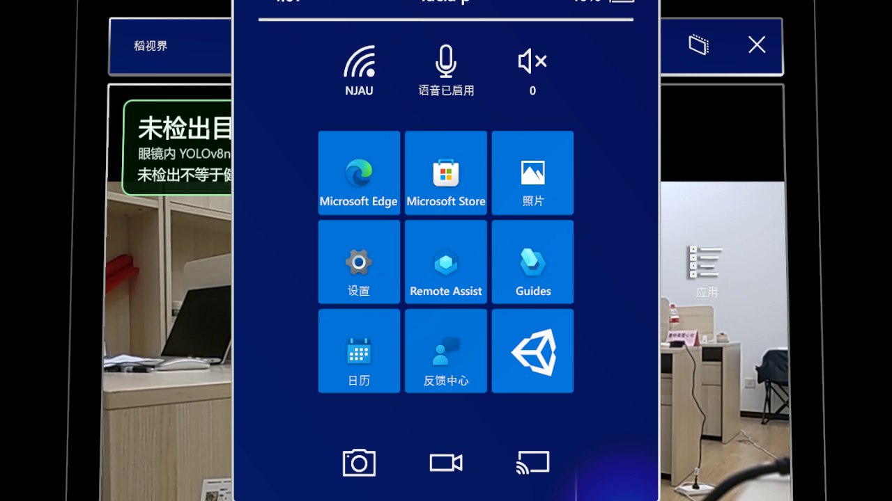
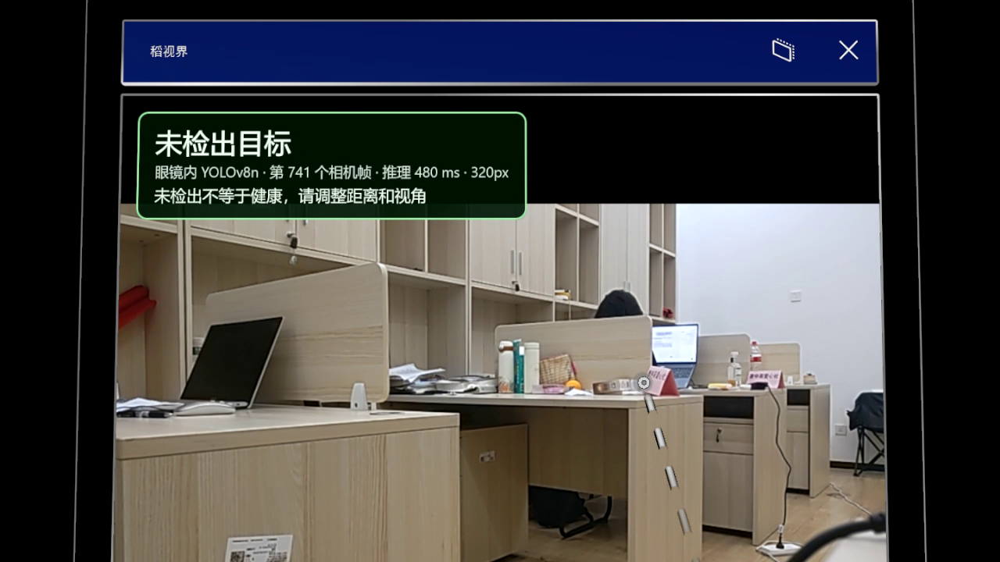
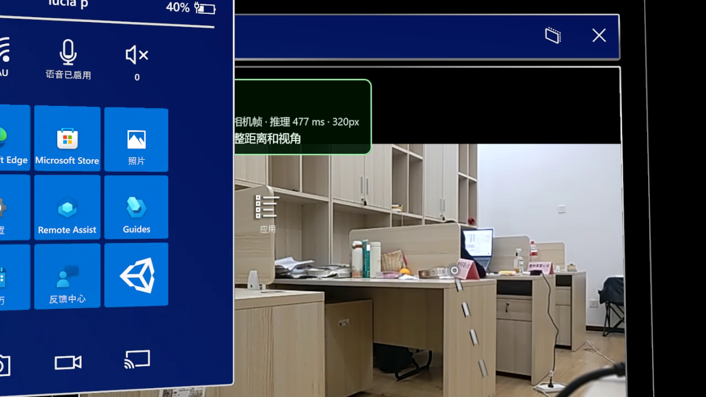
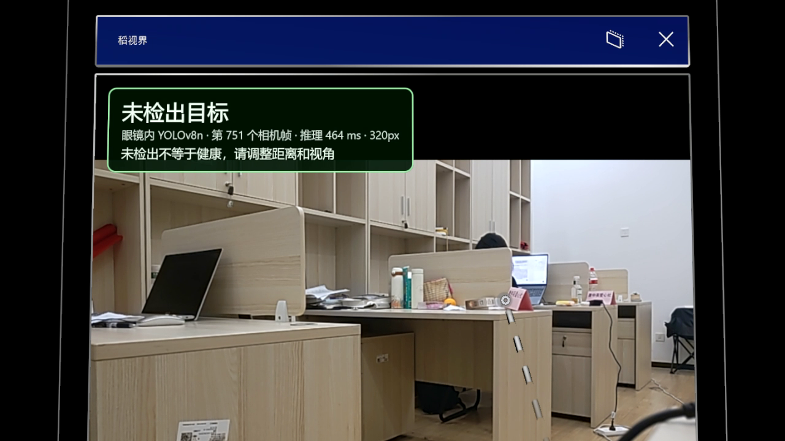
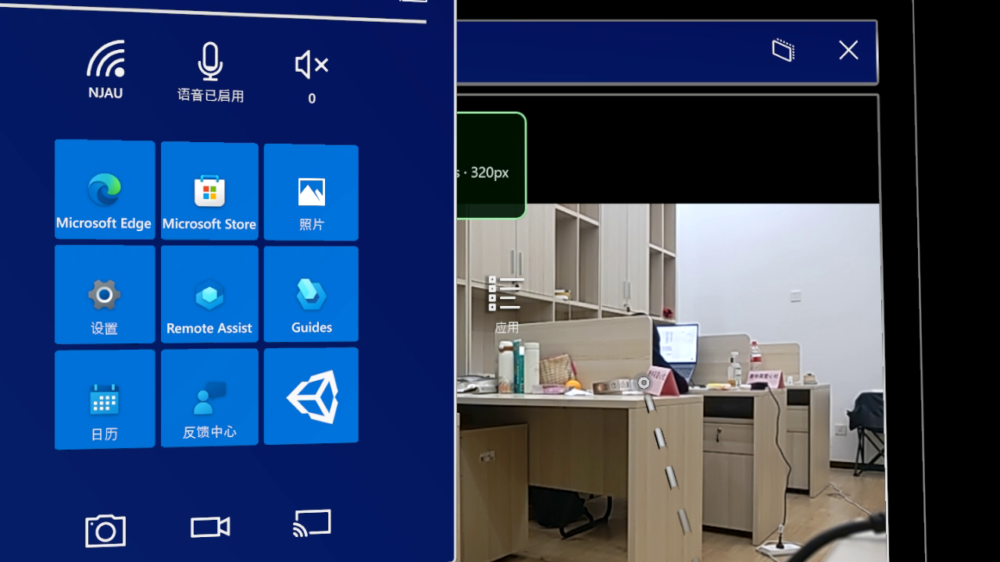
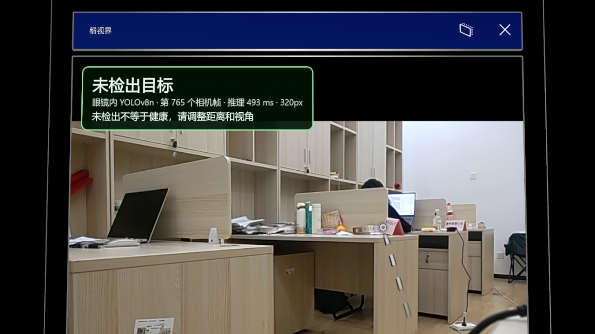

# 稻视界启动流程录像（2026-11-06）

## 目标

连接原 HoloLens（HOLOLENS-I0IHKJ），录一段 15 秒视频：从系统主菜单到打开稻视界，并展示应用内部画面。

## 连接与身份核对

- `Test-Connection.ps1`：SSH 身份 HOLOLENS-I0IHKJ / 169.254.112.215，门户证书已固定，`/api/os/info` 与 `/api/holographic/simulation/control/mode` 均 200。
- 应用：`Rice.HoloLens.Field_r5420n6798s24!Field`，版本 1.0.0.63，`Get-AppState.ps1` 返回 `verified_running`、`cameraPreviewReady=true`、会话持续产生 `dynamic_frame`。

## 录制通道

- 画面来自门户官方 MRC 直播码流 `/api/holographic/stream/live_high.mp4?holo=true&pv=false&mic=false&loopback=false`，1280×720，`holo=true` 保留全息层；单次请求上限 15 秒（`Get-PortalLiveSample.ps1` 的 `ValidateRange(1,15)`）。
- 手势输入走 `Control-Lease.ps1`（设备端 300 秒具名保护）+ `Start-PerceptionControl.ps1`（官方 x86 SDK 模拟手）。
- 新增 `ops/Record-ControlSegment.ps1`：一个进程内同时启动录制子进程和控制器，按预声明时间轴发送 `home`/`look-absolute`/`hand`/`tap`，解决此前“录制与输入两个命令行不同步”的问题（本机工具调用实际串行，导致点按总是在录制结束后才发出）。
- 新增 `ops/Invoke-ControlSequence.ps1`：按绝对时间轴发送一串已声明命令，同名 RunId 只读不重放。

## 已取得素材

| 文件 | 时长 | 内容 | 证据 |
| --- | --- | --- | --- |
| `稻视界-应用内展示-15s.mp4` | 15 秒（容器头标 12.7 秒） | 稻视界窗口全屏：标题栏“稻视界”、绿色“未检出目标”提示（眼镜内 YOLOv8n · 帧号 · 推理 ~470–500 ms · 320px）、相机预览与桌面场景 | `.state/live/final-video-20261106-a/` |
| `稻视界-开始菜单-12s.mp4` | 12.7 秒 | HoloLens 开始菜单（用户 lucia p、NJAU 网络、磁贴与应用按钮），右侧同时可见稻视界窗口 | `.state/live/startup-demo-20261106-take5/` |

## 关键帧图集

两段录像各取首、中、末 3 帧，随本报告一同发布。`apps/holographic-control/.state/live/` 下的全部逐帧截图、原始 `live.mp4` 和运行记录仍保存在本机，不进入仓库。

| 开始菜单段（12.7 秒） | 应用内展示段（15 秒） |
| --- | --- |
|  |  |
|  |  |
|  |  |

开始菜单段可见居中面板（Edge / Store / 照片 / 设置 / Remote Assist / Guides / 日历 / 反馈中心）与右侧稻视界窗口；应用内段可见标题栏“稻视界”、“未检出目标”提示、眼镜内 YOLOv8n、相机帧号、推理约 464–480 ms 与 320px 模型输入。图片为 MRC 直播抽帧，未经裁剪或添加标注。

## 未完成项与原因

- 目标“一次 15 秒内完成 主菜单 → 打开稻视界 → 应用内部”未能落地成片。
- 观察到的事实：
  1. 开始菜单由 `home` 手势唤出，可稳定出现在画面中。
  2. 应用在前台时，用 `Start-App.ps1`（AUMID 激活）不会自动收起开始菜单；菜单收起的可靠方式是在面板外点按，但该动作需要先把视线转开再转回，单次 15 秒片段里时间与姿态都不稳定。
  3. 未在开始菜单磁贴中找到稻视界（磁贴仅 Edge/Store/照片/设置/Remote Assist/Guides/日历/反馈中心），真实“点磁贴”路径需先点右侧“应用”进入全部应用列表，模拟手对该按钮的命中尚未验证成功。
  4. 17:12 之后设备进入待机：`Invoke-HoloLensWake.ps1` 返回 `awake_without_video`（awake=true、videoFrames=0），MRC 直播持续只回同一帧（每次 3 秒仅 11–47 KB）。已按项目既有策略重新启用 USB 功耗保活（45 秒心跳覆盖 DC 休眠/无人值守/显示超时），未绕过安全设计直接发重启请求。
- 因此最后一段 15 秒片段只拍到应用内部，开始菜单与打开动作分别落在另外两段里。

## 复做（设备唤醒后）

```powershell
# 1) 唤起开始菜单（会居中放置面板）
runtime/powershell/pwsh.exe -NoProfile -File apps/holographic-control/ops/Control-Lease.ps1 -Mode Start -RunId <新名字>
runtime/powershell/pwsh.exe -NoProfile -File apps/holographic-control/ops/Invoke-ControlSequence.ps1 -RunId <新名字> -Steps "0.2:look-absolute 0 0 0|0.9:home"

# 2) 15 秒录像 + 片段内点按（LeadSeconds 为录制开始到控制器就绪的提前量）
runtime/powershell/pwsh.exe -NoProfile -File apps/holographic-control/ops/Record-ControlSegment.ps1 `
  -RunId <新名字> -CaptureRunId <新名字> -Seconds 15 -VideoProfile Detail -LeadSeconds 2.4 `
  -Steps "0.2:look-absolute 0 -0.5 0|0.4:hand on|0.6:tap|1.4:look-absolute 0 0 0"
```

容器头时长会比实际短（码流被截断，moov 未收尾），用 `ffmpeg -i live.mp4 -c copy -movflags +faststart fixed.mp4` 重封装后再播放。

## 限制

- 每段录像上限 15 秒，无法覆盖更长流程；需要更长内容只能多段。
- 头显离头/待机时 MRC 不出新帧，必须由人唤醒（戴上或按电源键），远程唤醒在该状态下无效。
- 根目录 `README.md` 未修改。
